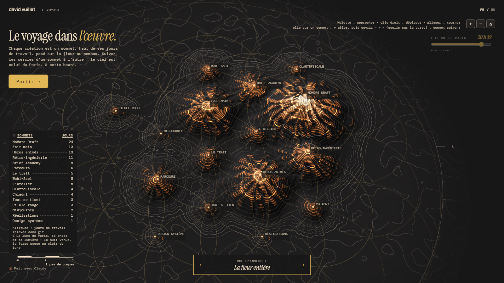

# Le relevé

**Votre historique git, levé en paysage sur la fleur de vie.**



Chaque création est un **sommet**, aussi haut que ses **jours de travail** (les jours où git l'a vue changer). Les sommets sont posés **au compas** sur la fleur de vie : chaque cercle part du précédent, avec la même ouverture. On voyage d'un sommet à l'autre le long des cercles, et chaque création s'ouvre sur place.

Le ciel est vrai : le soleil et la lune du lieu choisi, à son heure. Le jour, le relevé est un plan coté que le soleil ombre. La nuit tombée, il passe à la forge, sous la lune et dans sa phase.

Démo : [labskull-33.github.io/le-releve](https://labskull-33.github.io/le-releve/) · en situation : [davidvuillet.fr/voyage](https://davidvuillet.fr/voyage/) · *English: [README.md](README.md)*

## Essayer

Aucune installation : des modules ES et Three.js chargé depuis un CDN.

```sh
git clone https://github.com/labskull-33/le-releve.git
cd le-releve
python -m http.server 8000      # ou tout autre petit serveur
```

Ouvrez http://localhost:8000. Pour le mettre en ligne, n'importe quel hébergement statique convient, GitHub Pages compris (Réglages → Pages → déployer depuis la branche).

## Votre œuvre

Tout se règle dans **`oeuvre.json`**. La page n'a rien à changer.

```json
{
 "auteur": { "nom": "votre nom", "site": "https://votre-site.fr" },
 "site": "https://votre-site.fr",
 "ciel": { "lieu": "Lyon", "latitude": 45.764, "longitude": 4.8357, "fuseau": "Europe/Paris" },
 "depots": { "site": "../mon-site", "outil": "../mon-outil" },
 "creations": [
  {
   "nom": "Accueil", "pas": [], "url": "/",
   "fr": { "titre": "Tout part d’un <em>point.</em>", "texte": "…" },
   "en": { "nom": "Home", "titre": "Everything starts from a <em>point.</em>", "texte": "…" },
   "releve": [{ "depot": "site", "chemins": ["index.html", "accueil"] }]
  },
  { "nom": "Mon outil", "pas": [1], "url": "/outil/", "fr": { … }, "en": { … },
    "releve": [{ "depot": "outil", "chemins": ["."] }] }
 ]
}
```

- **`pas`** : la place au compas. `[]` pour la première création, au centre. Chaque chiffre est un pas de la même ouverture : `1` vers le haut, puis `2` à `6` de 60° en 60° dans le sens des aiguilles d'une montre. `[1, 2]` = un pas vers le haut, puis un pas à 60°. La première création est le cœur ; les autres en partent, comme on trace la fleur.
- **`url`** : l'adresse de la création, relative à `site`. Elle s'ouvre dans la planche, puis en grand.
- **`releve`** : où compter ses jours. Un dépôt de `depots` (chemin relatif à `oeuvre.json`) et des `chemins` dans ce dépôt (`"."` = tout le dépôt, `":!dossier"` = sauf ce dossier), ou un `"grep"` sur les messages des commits. Les jours de plusieurs sources s'additionnent sans doublon.
- **`depots.local.json`** (facultatif, hors de git) : les mêmes noms de dépôts avec leurs chemins sur votre machine, s'ils diffèrent de ceux d'`oeuvre.json`.
- **`ciel`** : le lieu du soleil et de la lune, et son fuseau horaire.

## Relever les jours

```sh
node relever.mjs                 # lit oeuvre.json, écrit jours.json
```

Relancez-le quand vous voulez : les montagnes grandissent avec votre travail, sans rien reconstruire. Un commit qui touche cinq créations ou plus avec de toutes petites retouches (une icône, un script commun) ne compte pour aucune.

Pour un relevé automatique chaque nuit sur GitHub, copiez `exemples/releve-chaque-nuit.yml` dans `.github/workflows/`. L'action ne voit que les dépôts présents sur GitHub, pas ceux de votre ordinateur.

## Dans le dépôt

| | |
|---|---|
| `index.html` | le voyage : la page, le compas, la planche |
| `src/relief.js` | le relief (Three.js) : le terrain, les courbes, les ombres, le ciel, la forge |
| `src/releve.js` | l'entrée du relief, avec ses réglages par défaut (`src/reglages.js`) |
| `relever.mjs` | le relevé des jours dans git |
| `oeuvre.json`, `jours.json` | l'exemple : l'œuvre de David Vuillet |

## Licence

Le code est sous licence **MIT**. L'exemple (textes, données, aperçu et œuvres liées) reste © David Vuillet, tous droits réservés : remplacez-le par le vôtre. Polices sous SIL Open Font License. Voir [LICENSE](LICENSE).

Né le 12 octobre 2026 sur [davidvuillet.fr](https://davidvuillet.fr), fait avec Claude.
